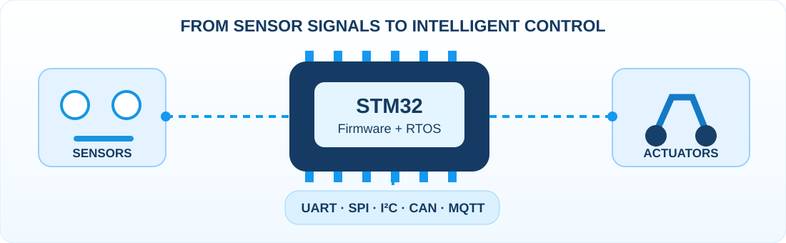

<div align="center">



### 👋 Welcome to my engineering workspace

**Embedded Firmware • Real-Time Systems • Embedded Linux • Industrial IoT**

[](https://www.linkedin.com/in/mohammed-al-dreamly-924317286/)
[](mailto:aldreamly.moh@gmail.com)


</div>

---

### ⚡ Professional Summary

Mechatronics Engineering student focused on **embedded firmware and real-time control**, with hands-on development on **STM32 and ESP32**. My experience includes **register-level peripheral drivers**, **interrupt/DMA-based firmware**, **FreeRTOS/CMSIS-RTOS**, sensor and actuator control, debugging, testing, and technical documentation.

My technical interests and working knowledge span **MCU/board selection**, embedded development from **requirements through hardware/software integration and validation**, robotic mechanism design, PCB design, and IoT connectivity.

- 🎓 **B.Sc. Mechatronics Engineering** — Al-Azhar University, Gaza (expected 2027)
- 🔬 **Focus:** Low-level Embedded C, ARM Cortex-M, RTOS and reliable device firmware
- 🐧 **Currently expanding:** Embedded Linux and systems development

<div align="center">

</div>

### 🧰 Technical Skills & Tools

<div align="center">


</div>

| Area | Skills / Tools |
|:--|:--|
| **Programming & Architecture** | Embedded C, C++, basic Python, modular firmware, state machines |
| **MCUs & RTOS** | STM32F103 (ARM Cortex-M3), ESP32-S3, ATmega32, custom educational RTOS scheduler, FreeRTOS, CMSIS-RTOS v2, tasks, queues, mutexes, event flags and timers |
| **Peripherals & Communication** | GPIO, EXTI/NVIC, UART/USART, SPI, I²C, ADC, DMA, timers/PWM; CAN fundamentals, CANoe/CAPL and PCAN-USB FD labs |
| **Low-level Firmware** | Memory-mapped I/O, register-level drivers, startup code, linker scripts, memory sections, MSP/PSP, SVC, PendSV and SysTick |
| **Debugging & Development** | **Keil µVision**, **STM32CubeIDE**, **GDB**, **OpenOCD**, **ST-Link**, JTAG/SWD, logic-analyzer workflow, **Proteus**, **Git/GitHub**, **Make/CMake** |
| **Sensors, Control & IoT** | MPU6050, ultrasonic, GPS/GNSS and Bluetooth modules; PID concepts, sensor/actuator integration, MQTT, TCP/IP, device-to-cloud workflows |
| **Engineering Workflow** | Datasheet/reference-manual navigation, pin multiplexing, PCB/BOM planning, UML, requirements, Jira/Scrum, test-case design, integration & validation, MISRA-C awareness |

<sub>Hands-on tools, technical training and working knowledge are grouped as described in my CV; familiarity with a technology does not imply professional mastery.</sub>

### 🧠 Things I Like Working With

```text
[ MCU ] ── GPIO / EXTI / UART / SPI / I2C / CAN ── [ Peripherals ]
   │
   ├── Bare-metal drivers & interrupts
   ├── RTOS tasks, queues & scheduling
   ├── Debugging, testing & hardware integration
   └── Embedded Linux & connected devices
```

### 🐍 Contributions in Motion

<div align="center">


<sub>The snake is generated by GitHub Actions and will appear after the first successful workflow run.</sub>

</div>

---

<div align="center">

**Keep learning. Keep building. Keep improving.**

<sub>Designed with a clean white engineering aesthetic · Built for the GitHub profile of Mohammed Al Dreamly</sub>

</div>
